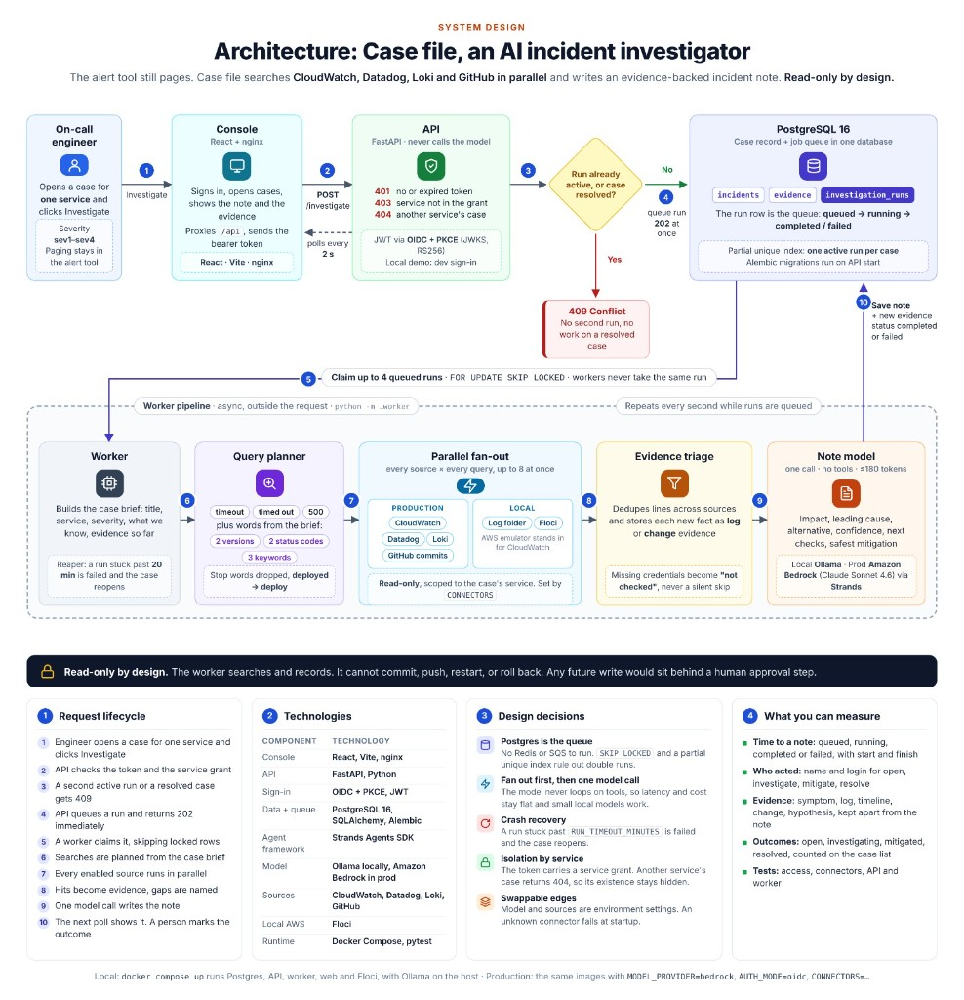

# Case file

On-call engineers lose the first minutes of an incident to the same hunt: CloudWatch, Datadog, Loki, and GitHub, then a note written by hand. Case file does that hunt and leaves a record a person can act on.

The alert system still pages. This service writes the investigation. The numbers on the diagram are the order.



## One investigation

1. An engineer opens a case for one service and clicks Investigate.
2. The API checks the token and the service grant. No token is 401. A service outside the grant is 403. Another service's case is 404.
3. A case that is resolved, or already has a run in progress, is refused with 409. A queue that already holds 32 waiting runs, unless `MAX_QUEUED_RUNS` says otherwise, is refused with 429.
4. A clear case is queued. The API returns 202. It does not call the model.
5. A worker, outside that request, claims up to four queued runs with `FOR UPDATE SKIP LOCKED`.
6. It builds a brief from the case and searches the systems this company has enabled. The searches run together, and they are read-only.
7. One model call writes the note. Evidence stays apart from that prose: symptom, log, timeline, change, hypothesis.
8. The console poll shows the note. A person marks the case mitigated or resolved.

The worker searches and records. It cannot commit, push, restart, or roll back.

## What you can measure

| Measure | What the product records |
| --- | --- |
| Time to a note | Each run moves from queued to running to completed or failed, with a start and a finish |
| Who acted | Each status change keeps the name and login. The case also stores the latest opener, mitigator, and resolver |
| Scope | One service per case. A checkout case cannot read payments logs |
| Outcome | Open, investigating, mitigated, or resolved, with counts on the case list |
| Evidence | Symptoms, log lines, timeline entries, changes, and hypotheses, kept apart from the prose note |

Severity is `sev1` through `sev4`. Paging stays in the existing alert tool.

## What the build shows

| Part | In this build |
| --- | --- |
| Search | 4 production systems (CloudWatch, Datadog, Loki, GitHub), or a local log folder |
| Model | Amazon Bedrock in production, Ollama locally. The console does not change |
| Login | Company identity provider in production (OIDC, PKCE). The demo username and password start only when `APP_ENV=local`. Production refuses to start with `AUTH_MODE=dev` |
| Access | No token is 401. A service the token does not grant is 403. Another service's case is 404 |
| Work split | The API returns immediately. A worker asks the model and writes the note |
| Safety | The worker searches and records. It cannot commit, push, restart, or roll back |
| Trace | Worker lines for one run end with that case id and that run id |
| Search bound | A connector call that does not finish is failed for that source. The other sources are kept. The run does not stay in progress until the 20-minute timeout |
| Stored errors | A failed run keeps the error with tokens and configured secrets replaced. A connector failure that is not an HTTP response is stored the same way |
| Status history | Open, investigating, mitigated, and resolved are kept in order. A finished run records the return to open. A later edit does not erase the earlier one |
| Queue | At most 32 runs may wait. A further Investigate returns 429 until one of them starts. A running or finished run does not count |
| Tests | 81 automated tests for access, connectors, the API, and the worker |
| Stack | Python, FastAPI, Postgres, Alembic, React |

## Run it

Docker Desktop is enough. The API applies database migrations on startup.

```bash
docker compose up --build
```

Open http://localhost:8080.

| Username | Password | Services |
| --- | --- | --- |
| `oncall` | `oncall-local` | checkout and payments |
| `platform` | `platform-local` | every service |

Choose "Use the checkout sample", open the case, and choose Investigate.

```bash
pytest
```

Production sets `APP_ENV=prod`, `MODEL_PROVIDER=bedrock`, and `AUTH_MODE=oidc`, and turns on only the systems this company uses with `CONNECTORS`.
